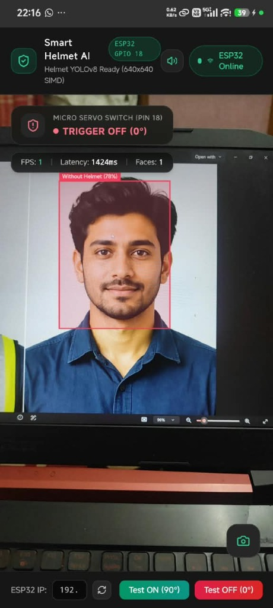
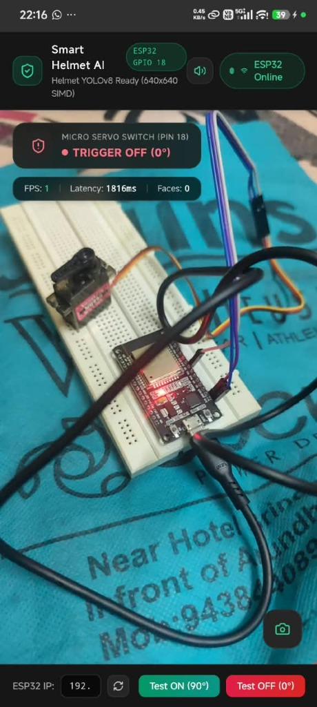
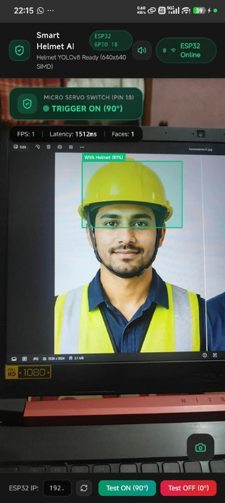
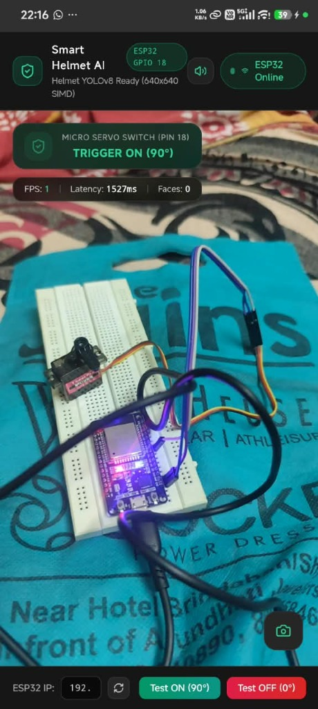

# 🪖 Smart Helmet Monitor (AI Computer Vision + ESP32 Actuation)

An AI-driven safety compliance and hardware actuation ecosystem. The system runs real-time YOLOv8 neural network inference via ONNX Runtime Web on mobile/edge devices to detect safety helmet compliance. Upon confirming safety helmet presence, it wirelessly signals an ESP32 microcontroller to actuate a micro servo on **GPIO 18** (Switching ON to 90°), or disables the trigger (Switching OFF to 0°) when no helmet is detected.

---

## 🚀 Key Features

- **On-Device YOLOv8 Inference**: Real-time neural detection running entirely client-side via ONNX Runtime Web with WebAssembly SIMD acceleration.
- **Hardware Trigger Integration**: Communicates over local WiFi with an ESP32 running an asynchronous REST endpoint (`/trigger`, `/status`).
- **TowerPro MG90S Actuation**: Actuates servo on **GPIO 18** based on safety state transitions.
- **Debounced Safety Engine**: Eliminates jitter with frame hysteresis and state deduplication.
- **Mirrored Selfie HUD**: Live mirrored front camera preview, visual telemetry (FPS, Latency, Face Counter), and responsive testing controls.
- **Android Native Binding**: Native Capacitor Android application with automatic WiFi process binding for AP connections without internet.

---

## 📸 Experimental Results & Hardware Demonstration

The system was evaluated in real-time under practical safety inspection conditions:

### Case 1: Unprotected Head (Trigger OFF - 0°)
When a person without a safety helmet is detected in frame, the YOLOv8 model classifies the head as **Without Helmet** (Red Box). The app signals the ESP32 over WiFi to maintain/return the TowerPro MG90S servo to **0° (TRIGGER OFF)**.

| Mobile App Detection (Without Helmet) | ESP32 Hardware Status (Servo at 0°) |
| :---: | :---: |
|  |  |

### Case 2: Safety Helmet Verified (Trigger ON - 90°)
When a safety helmet or hard hat is worn, the neural model detects it with high confidence (**With Helmet 81%**, Green Box). The system triggers the ESP32 on **GPIO 18**, rotating the MG90S micro servo to **90° (TRIGGER ON)**.

| Mobile App Detection (With Helmet 81%) | ESP32 Hardware Actuation (Servo at 90°) |
| :---: | :---: |
|  |  |

---

## 🛠️ System Architecture

```text
[ Mobile / Tablet Camera ]
           │
           ▼
[ YOLOv8 ONNX Runtime (WASM SIMD) ]
  ├── Class 0: With Helmet    --> [ Green Box + Audio Confirmation ]
  └── Class 1: Without Helmet --> [ Red Box + Warning Beep ]
           │
     (State Debounced)
           │
           ▼
[ Local HTTP REST API (192.168.4.1) ]
           │
           ▼
[ ESP32 Microcontroller (Access Point Mode) ]
           │
    (PWM Signal on GPIO 18)
           │
           ▼
[ TowerPro MG90S Micro Servo ]
  ├── Helmet Detected    --> Angle: 90° (Trigger ON)
  └── No Helmet Detected --> Angle: 0°  (Trigger OFF)
```

---

## 📁 Repository Structure

```text
├── android/               # Native Android Capacitor wrapper project
├── esp32_firmware/        # Arduino/C++ firmware for ESP32 & MG90S servo
│   └── esp32_firmware.ino # Main ESP32 sketch (WiFi AP + HTTP REST Server)
├── public/                # Static assets, logos, and ONNX neural models
│   └── models/            # Quantized YOLOv8 ONNX model & configuration
├── src/                   # React + TypeScript frontend application
│   ├── components/        # React components (ErrorBoundary, HUD, etc.)
│   ├── utils/             # Inference engine, ESP32 client, color themes
│   ├── App.tsx            # Main camera detection loop & state orchestration
│   └── main.tsx           # Application entrypoint
├── Smart_Helmet_Monitor.apk # Pre-built signed release APK
├── capacitor.config.json  # Capacitor native configuration
└── package.json           # Frontend dependencies and build scripts
```

---

## ⚡ Getting Started

### 1. ESP32 Setup
1. Open [esp32_firmware/esp32_firmware.ino](esp32_firmware/esp32_firmware.ino) in Arduino IDE.
2. Install the **ESP32Servo** library from Arduino Library Manager.
3. Select board: `ESP32 Dev Module`.
4. Connect TowerPro MG90S Micro Servo:
   - **Signal (Orange/Yellow)**: GPIO 18
   - **VCC (Red)**: 5V (or external 5V supply)
   - **GND (Brown/Black)**: GND
5. Flash the sketch to your ESP32.
6. The ESP32 will broadcast a WiFi Access Point:
   - **SSID**: `SmartHelmet_AP`
   - **Password**: `helmet1234`
   - **Default IP**: `192.168.4.1`

### 2. Frontend Development
```bash
# Install dependencies
npm install

# Start local development server
npm run dev
```

### 3. Android Release Build
```bash
# Build web distribution and sync to Android
npm run build
npx cap copy android

# Build signed release APK
cd android
./gradlew assembleRelease
```
The output APK will be generated at:
`android/app/build/outputs/apk/release/app-release.apk`

---

## 🔒 Security & Privacy
- **Zero Cloud Video Ingestion**: All camera frames are processed entirely on-device inside WebAssembly memory. No video or biometric data leaves the device.
- **Restricted Cleartext Routing**: Network security configuration explicitly limits cleartext communication to local ESP32 IP boundaries (`192.168.4.1`, `192.168.*`, `localhost`).
- **Least Privilege**: Manifest is strictly trimmed to necessary camera and network state capabilities.

---

## 📄 License
This project is licensed under the MIT License.
